<div align="center">

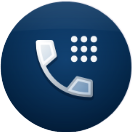

# MHW Phone

**A calm, glass-styled phone app for Android: dialer, contacts and call history, built on [Right Dialer](https://github.com/Goodwy/Dialer).**


[](https://github.com/mhwazrah/Dialer/releases/latest)

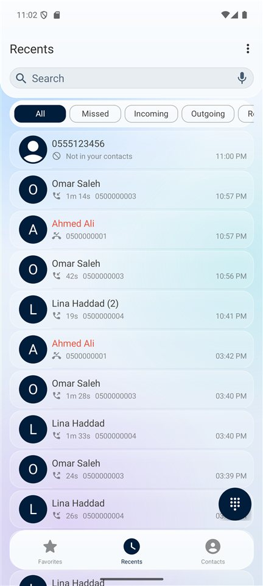
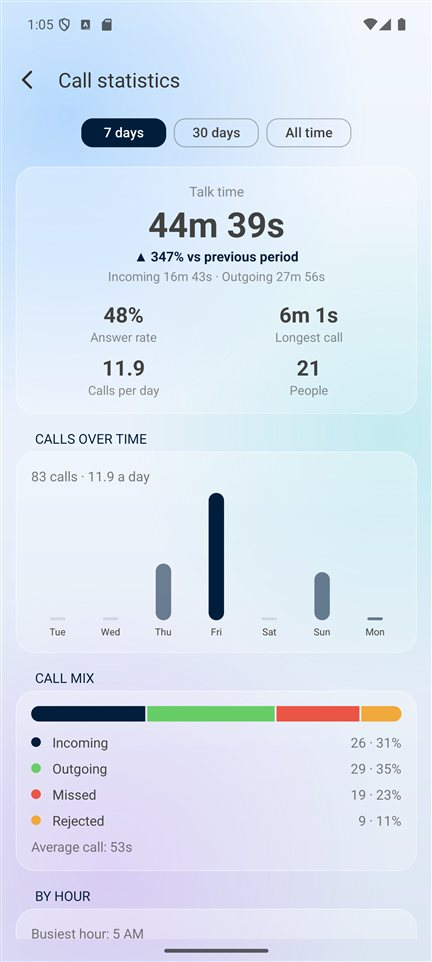
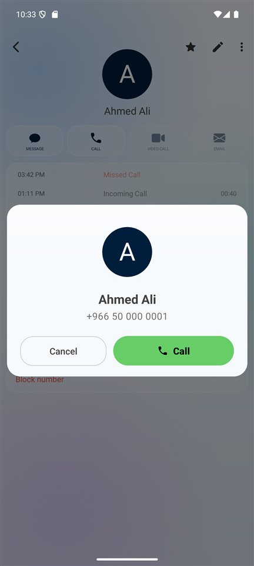
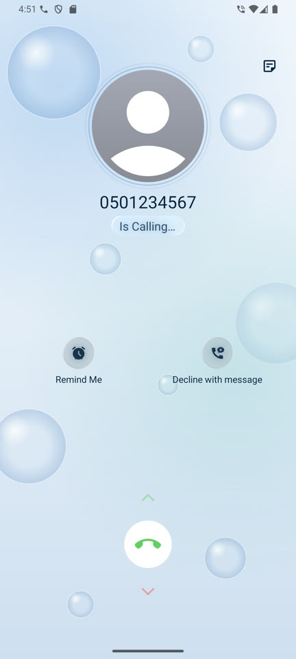

</div>

## About

MHW Phone is a fork of **Right Dialer** by Goodwy. It keeps everything Right Dialer does well and adds a new look, smarter call
handling, statistics, widgets and full Arabic support. Set it as your default phone app and it handles every call itself.

## What's new on top of Right Dialer

### 🎨 Design
- **Liquid Glass look** throughout: frosted cards and bars that stay readable, a pill-style dialpad with bigger keys, and page titles in the top bar.
- **Animated call screen** in light or dark with the theme: floating glass bubbles, a larger caller photo and evenly spaced buttons on the incoming, dialing and in-call screens.
- **Redesigned dialogs**: tonal buttons, and a call confirmation that shows the caller's photo, name and number with a soft pulse.
- **Simplified settings**: fewer, clearer options, with the glass style on every screen.

### 📞 Calls
- **Speak the caller's name** when the phone rings (optionally only with headphones or Bluetooth).
- **Flip to silence**: turn the phone face down to silence a ringing call.
- **Decline with a message**: the quick replies are now a list of any length you edit yourself.
- **Remind me to call back** now also from Recents (10, 30 or 60 minutes) and from the missed-call notification (30 minutes), one reminder per number.
- **Caller notes** are included in the settings backup and merged on restore.
- **Wi-Fi calling / mobile network indicator** on the call screen.
- **Pick a specific Bluetooth device** for call audio, and a reworked call notification.
- More reliable call screen and call waiting; calls placed from anywhere go through MHW Phone.

### 🗂 Recents and contacts
- **Arabic-aware search and T9**: Arabic and English names match in search and on the keypad, with call frequency ranking the results (the first Arabic T9 work was also contributed upstream to Right Dialer).
- **New filters**: Blocked, and one per SIM when two SIMs are active.
- **Why a call was blocked**: on your block list, not in your contacts, hidden number or blocked by the system.
- **Dual-SIM picker**, an in-app contact page, a `*#06#` IMEI dialog and a collapsible favourites strip.
- **Send WhatsApp** straight from a contact or a recent call, and create-new or add-to-existing when saving a number.

### 📊 Call statistics
A dashboard worked out on the phone from your call log, for 7 days, 30 days or all time:
- Talk time with incoming and outgoing split, and the change against the previous period.
- Answer rate, longest call, calls per day and number of people.
- Charts of calls over time, by hour of the day and by weekday.
- The call mix (incoming, outgoing, missed, rejected) and the people you call most.

### 🏠 Widgets
- **Favorites** and **Recent calls** home-screen widgets: one tap goes through the usual SIM choice and call confirmation.

### 🛡 Blocking and privacy
- A redesigned blocked-numbers screen, and a log of why each call was blocked.
- No ads and no account. Statistics, notes and block reasons are worked out and kept on the phone.

### 🌍 Languages
- Arabic throughout, with right-to-left layouts. Text added by MHW Phone is translated into every language the app ships (57); apart from English and Arabic those new strings are machine-written, so corrections are welcome.

### 🧪 Quality
- Unit tests for the app logic, working lint and detekt checks, and faster Gradle builds.

### Inherited from Right Dialer
Everything Right Dialer already offers stays: themes, speed dial, call blocking (numbers, patterns, unknown and hidden callers),
caller notes, the Missed / Incoming / Outgoing / Rejected / Contacts filters, a remembered SIM per number, the HD call badge,
messenger shortcuts and more.

## Screenshots

<div align="center">
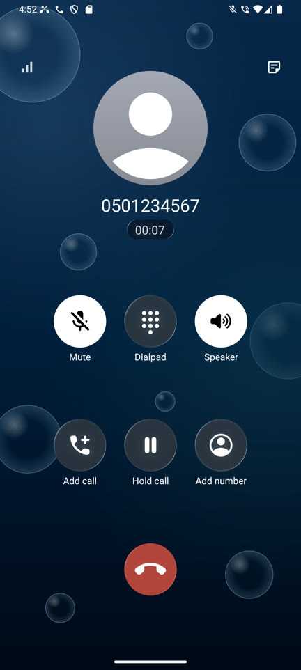
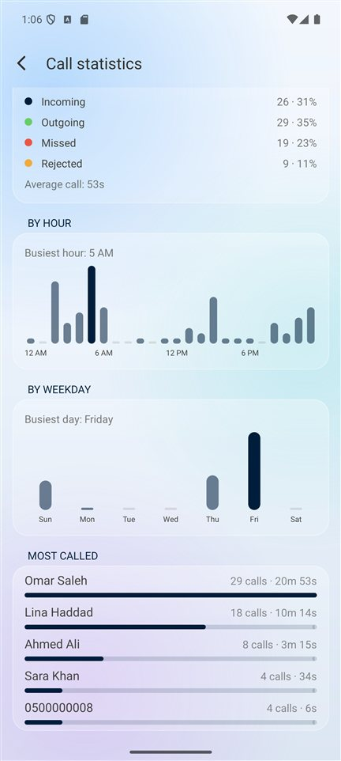
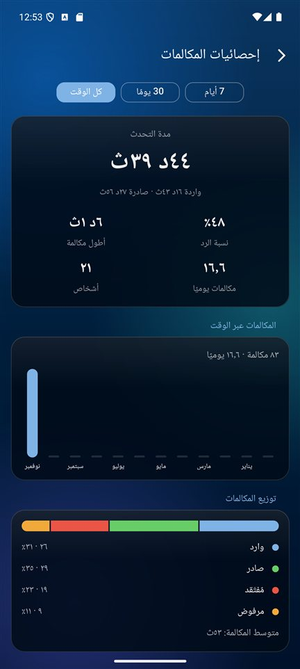
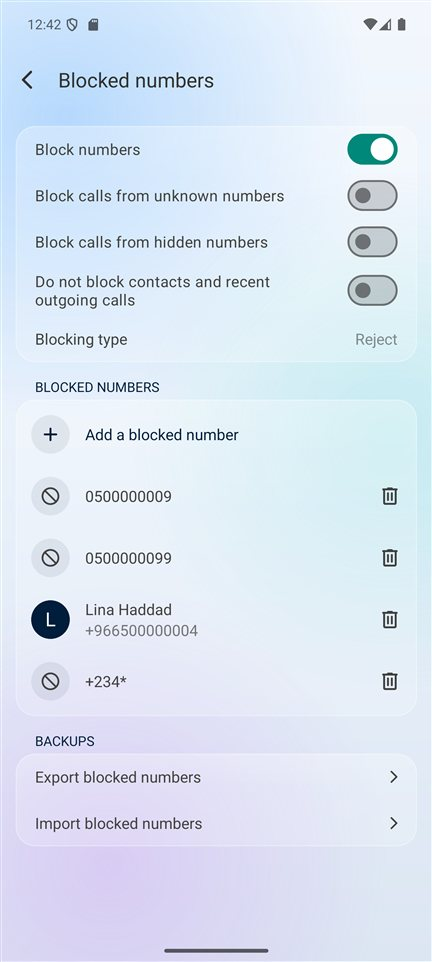
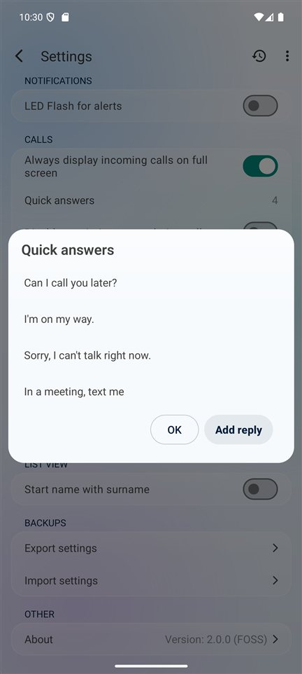
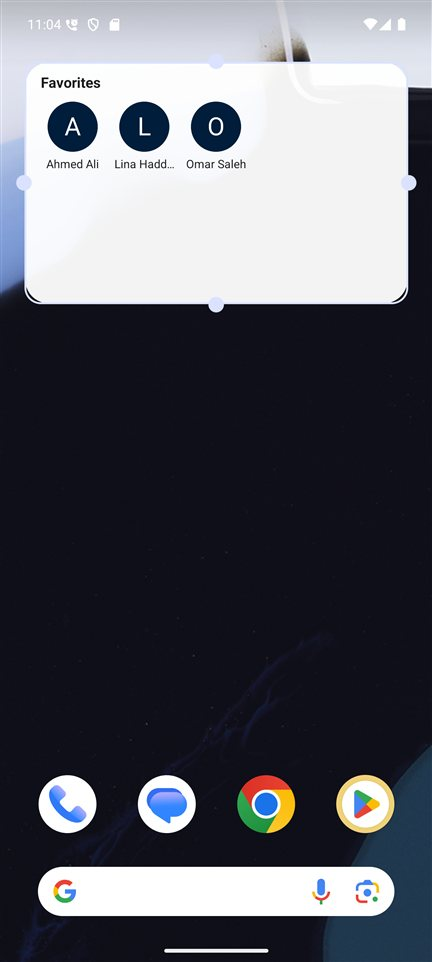
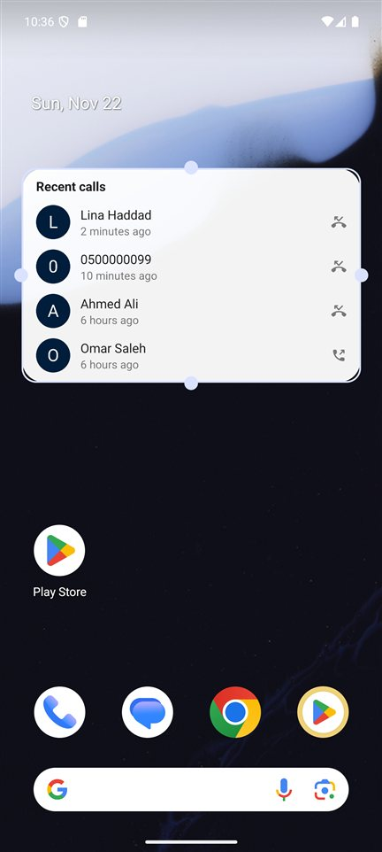
</div>

## Building

Requirements: Android Studio (or JDK 17+) and the Android SDK.

```
./gradlew assembleFossDebug          # debug build
./gradlew testFossDebugUnitTest      # unit tests
./gradlew lintFossDebug detekt       # checks
```

Release builds read signing details from a local `keystore.properties`, which is never committed.

## Thanks

A big thank you to **[Goodwy](https://github.com/Goodwy)** for **[Right Dialer](https://github.com/Goodwy/Dialer)**, the foundation this
app is built on, and for the goodwy-commons library it uses. If you like MHW Phone, please consider supporting the original work:

[](https://www.buymeacoffee.com/goodwy)

Right Dialer itself is based on [Simple Dialer](https://github.com/SimpleMobileTools/Simple-Dialer) and
[Fossify Phone](https://github.com/FossifyOrg/Phone). Thanks to everyone who contributed to those projects.

## License

MHW Phone is free software under the [GNU General Public License v3.0](LICENSE), like the projects it is based on.
